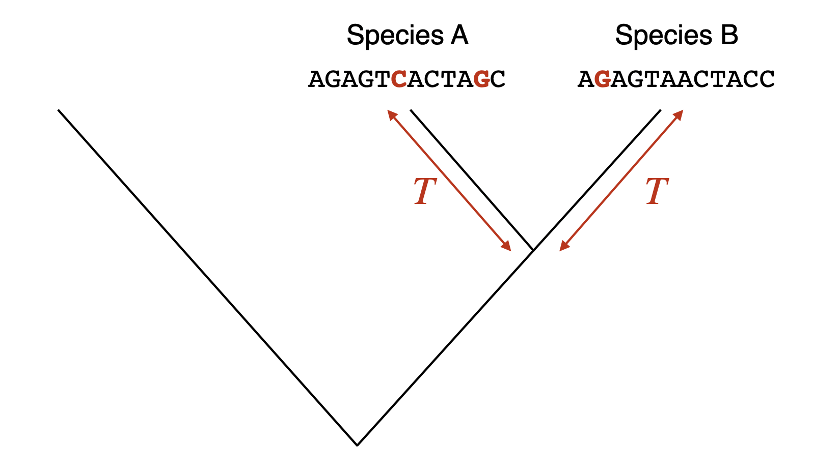

```{python}
#| echo: false
#| output: false
import numpy as np
import matplotlib.pyplot as plt
import matplotlib.transforms as transforms
import seaborn as sns
import vscodenb
sns.set_style('ticks')
```


## DNA sequence divergence across time {#sec-molevo-divergence}

Every time a cell divides, it copies its DNA, and sometimes the copy has a mistake. Most mutations that get passed on through generations are neutral: they change the DNA without changing anything the organism depends on. Because neutral mutations arise at a roughly steady rate and selection neither favors nor removes them, they pile up in a lineage like the ticks of a clock. This is the *molecular clock*. If you know how fast the clock ticks, you can read off how long it has been running from the number of differences it has left behind.

{width=60% #fig-molecular-clock}

@fig-molecular-clock shows the idea for a single lineage. In practice, we never have the ancestral sequence. We have two sequences from two living species, as in @fig-divergence-tree. Since the two species split from their common ancestor $T$ years ago, each lineage has been collecting substitutions for $T$ years, so the two sequences are separated by $2T$ years of evolution. If $K$ is the number of substitutions per site that separate them and $r$ is the substitution rate per site per year, then

$$
r = \frac{K}{2T} \qquad \text{and so} \qquad T = \frac{K}{2r}.
$$

{width=70% #fig-divergence-tree}

The two sequences in @fig-divergence-tree differ at 3 of their 12 sites, so $K = 0.25$. With $r = 5 \times 10^{-10}$, that gives $T = 0.25 / (2 \times 5 \times 10^{-10}) = 250$ million years. The calculation assumes that every substitution leaves a visible difference, and that is only true for closely related sequences. The rest of this section is about what happens when it is not.

### A model of DNA evolution {#sec-molevo-model}

<style>
evol {font-family: "Lucida Console", "Courier New", monospace; letter-spacing: 30%; font-weight: bold; color: #555555 ;}
rd { color: Red ; font-weight: bold; }
or { color: Orange ; font-weight: bold;  }
gr { color: Green ; font-weight: bold;  }
bl { color: Blue ; font-weight: bold;  }
</style>

::: {#fig-multiple-hits}

Distant past<br>
<evol>
GCTTGCACGA<br>
GCTTG<gr>A</gr>ACGA<br>
GCTTG<gr>A</gr>ACGA<br>
GCT<bl>C</bl>G<gr>A</gr>ACGA<br>
GCT<bl>C</bl>G<gr>A</gr>ACGA<br>
GC<gr>A</gr><bl>C</bl>G<gr>A</gr>ACG<rd>T</rd><br>
GC<gr>A</gr><rd>T</rd>G<gr>A</gr>ACG<rd>T</rd><br>
GC<gr>A</gr><rd>T</rd>G<gr>A</gr>ACG<rd>T</rd><br>
GC<gr>A</gr><rd>T</rd>G<or>G</or>ACG<rd>T</rd><br>
GC<gr>A</gr><rd>T</rd>G<or>G</or>ACG<rd>T</rd><br>
</evol>
Present

Six substitutions in a ten-base sequence, read from top to bottom. Only three differences between the first and last sequence are visible. The fourth base changed from T to C and back to T, and the sixth changed twice: first to A, then to G.

:::

@fig-multiple-hits follows one sequence through time. Six substitutions happen, but comparing the first sequence with the last shows only three differences. One site changed and then changed back, which leaves no trace, and another changed twice, which looks like one change. The longer the sequences have been evolving apart, the more often a site is hit more than once, and the more the observed proportion of differences underestimates the number of substitutions that actually happened. To correct for this, we need a model of how bases change over time: a way to compute the probability that a site holds base $x$ now, given that it held base $y$ at time $t$.

Think of a single site. Let $p_A(t)$ be the probability that it holds an A at time $t$, and likewise for the other three bases. Over a short time $\Delta t$, two things can change $p_A$. If the site is an A, it may mutate to another base at rate $\mu_A$. If it is another base $x$, it may mutate to A at rate $\mu_{xA}$. So

$$
p_A(t+\Delta t) = p_A(t) - p_A(t)\, \mu_A \Delta t + \sum_{x \neq A} p_x(t) \, \mu_{xA} \Delta t,
$$

where $\mu_A = \sum_{x \neq A} \mu_{Ax}$ is the total rate at which an A turns into something else. The same equation holds for each of the four bases. Collecting the four probabilities in a vector,

$$
\mathbf{p}(t) = (p_A(t),\ p_C(t),\ p_G(t),\ p_T(t)),
$$

all four equations can be written as one:

$$
\mathbf{p}(t + \Delta t) = \mathbf{p}(t) + \mathbf{p}(t)\,Q\,\Delta t,
$$

where $Q$ is the *rate matrix*. Its entry in row $x$ and column $y$ is the rate at which base $x$ mutates to base $y$, and each diagonal entry is minus the total rate of leaving that base, so that every row sums to zero:

$$
Q = \begin{pmatrix}
-\mu_A & \mu_{AC} & \mu_{AG} & \mu_{AT} \\
\mu_{CA} & -\mu_C & \mu_{CG} & \mu_{CT} \\
\mu_{GA} & \mu_{GC} & -\mu_G & \mu_{GT} \\
\mu_{TA} & \mu_{TC} & \mu_{TG} & -\mu_T
\end{pmatrix}
$$

Different models of DNA evolution are different choices for the twelve rates in $Q$.

### Jukes-Cantor model {#sec-molevo-jc}

The simplest model, from [Jukes and Cantor (1969)](https://doi.org/10.1016/B978-1-4832-3211-9.50009-7), assumes that every base mutates to each of the three others at the same rate, $\alpha$. With $\alpha = \mu / 4$, the rate matrix is

$$
Q = \begin{pmatrix}
-3\alpha & \alpha & \alpha & \alpha \\
  \alpha & -3\alpha & \alpha & \alpha \\
  \alpha & \alpha & -3\alpha & \alpha \\
  \alpha & \alpha & \alpha & -3\alpha
\end{pmatrix}
= \begin{pmatrix}
-\frac{3\mu}{4} & \frac{\mu}{4} & \frac{\mu}{4} & \frac{\mu}{4} \\
\frac{\mu}{4} & -\frac{3\mu}{4} & \frac{\mu}{4} & \frac{\mu}{4} \\
\frac{\mu}{4} & \frac{\mu}{4} & -\frac{3\mu}{4} & \frac{\mu}{4} \\
\frac{\mu}{4} & \frac{\mu}{4} & \frac{\mu}{4} & -\frac{3\mu}{4} \\
\end{pmatrix}.
$$

Letting $\Delta t$ shrink towards zero turns the equation for $\mathbf{p}$ into a differential equation, and for this simple $Q$ it can be solved by hand. The solution gives the probability of going from one base to another in time $t$, as a matrix $P(t)$ whose entry in row $i$ and column $j$ is the probability that a site holding base $i$ holds base $j$ at time $t$ later:

$$
P(t) = \left(
\begin{array}{cccc}
\frac{1}{4} + \frac{3}{4} e^{-t\mu}  & \frac{1}{4} - \frac{1}{4} e^{-t\mu} & \frac{1}{4} - \frac{1}{4} e^{-t\mu} & \frac{1}{4} - \frac{1}{4} e^{-t\mu} \\[1.5ex]
 \frac{1}{4} - \frac{1}{4} e^{-t\mu} & \frac{1}{4} + \frac{3}{4} e^{-t\mu} & \frac{1}{4} - \frac{1}{4} e^{-t\mu} & \frac{1}{4} - \frac{1}{4} e^{-t\mu} \\[1.5ex]
 \frac{1}{4} - \frac{1}{4} e^{-t\mu} & \frac{1}{4} - \frac{1}{4} e^{-t\mu} & \frac{1}{4} + \frac{3}{4} e^{-t\mu} & \frac{1}{4} - \frac{1}{4} e^{-t\mu} \\[1.5ex]
 \frac{1}{4} - \frac{1}{4} e^{-t\mu} & \frac{1}{4} - \frac{1}{4} e^{-t\mu} & \frac{1}{4} - \frac{1}{4} e^{-t\mu} & \frac{1}{4} + \frac{3}{4} e^{-t\mu} \\
\end{array}
\right)
$$

At $t = 0$, the diagonal entries are 1, and the others are 0: nothing has had time to change. As $t$ grows, every entry approaches $\frac{1}{4}$: after a very long time, the site is equally likely to hold any base, whatever it started as.

It is more useful to measure time by the number of substitutions that have actually happened per site, which we call $\nu$. A site leaves its base at the rate $\frac{\mu}{4} + \frac{\mu}{4} + \frac{\mu}{4}$, so

$$
\nu = \frac{3\mu}{4}\, t \quad \implies \quad t\mu = \frac{4}{3}\nu,
$$

and the transition probabilities become

$$
  P_{ij}(\nu) =
  \begin{cases}
    \, \frac{1}{4} + \frac{3}{4} e^{-4\nu/3} & \text{if } i = j\\[0.5ex]
    \, \frac{1}{4} - \frac{1}{4} e^{-4\nu/3} & \text{if } i \neq j
  \end{cases}
$$

When we compare two sequences, $\nu$ is the number of substitutions per site along the whole path from one sequence back to their common ancestor and forward to the other, which is the $K$ of the molecular clock. A site differs between the two sequences if it has ended up as any of the three other bases, so the expected proportion of sites that differ is

$$
p = 3\times \bigg(\frac{1}{4} - \frac{1}{4} e^{-4\nu/3} \bigg)= \frac{3}{4} - \frac{3}{4} e^{-4\nu/3}.
$$

@fig-jc-inverse-example shows what this means. For a short time, $p$ grows almost in step with the number of substitutions, along the dashed line. Then it bends away, because more and more new substitutions land on sites that already differ. Eventually $p$ levels off at $\frac{3}{4}$: two unrelated sequences still agree at a quarter of their sites, just by chance.

```{python}
#| echo: false
#| label: fig-jc-inverse-example
#| fig-cap: "The proportion of sites that differ between two sequences under the Jukes-Cantor model."
#| layout-ncol: 2
#| fig-subcap:
#|   - "With substitutions accumulating at $10^{-8}$ per site per year between the two sequences. The dashed line is what we would see if no site were ever hit twice. Three times as much time only a little more than doubles the proportion of differences."
#|   - "Against the number of substitutions per site, $\\nu$. However many substitutions have happened, the proportion of differences never exceeds 0.75 (dashed line)."

u = 1e-8

def jc(subst):
    return -3/4 * np.log(1 - 4/3 * subst) / u

def jc_inverse(t):
    return -3/4 * (np.exp(-4/3 * t * u) - 1)

fig, ax = plt.subplots(figsize=(4, 3))
ax.axline((0,0), (1,u), ls='--', color='#999999')

for x in np.array([0.2, 0.6]) / u:
  y = jc_inverse(x)
  ax.vlines(x, 0, y, lw=1, color='black')
  ax.annotate('', xy=(0, y), xytext=(x, y),
    arrowprops=dict(
          arrowstyle="-|>,head_length=0.7,head_width=0.3",
           color='black',
          lw=1),
    )
  ax.text(0.06, y+0.02, f'{y:.2f}', transform=transforms.blended_transform_factory(ax.transAxes, ax.transData))
ax.text(0.95, 0.1, rf'$\mu = ${u:.2g}', horizontalalignment='right', transform=ax.transAxes)
t = np.linspace(0.01, 1*1e8, 100)
ax.plot(t, jc_inverse(t), color='#0D7D92', lw=2)
ax.set_xlim(left=0)
ax.set_ylim(bottom=0)
ax.set_xlabel('time (years)')
ax.set_ylabel('proportion of sites that differ, $p$')
sns.despine()
plt.show()

fig, ax = plt.subplots(figsize=(4, 3))
ax.axhline(0.75, ls='--', c='#999999')
nu = np.linspace(0, 7, 200)
ax.plot(nu, 3/4 * (1 - np.exp(-4/3 * nu)), c='#0D7D92', lw=2)
ax.set_xlim(left=0)
ax.set_ylim(0, 0.8)
ax.set_xlabel(r'substitutions per site, $\nu$')
ax.set_ylabel('proportion of sites that differ, $p$')
sns.despine()
plt.show()
```

We observe $p$, but we want $\nu$. Solving the equation for $\nu$ gives the *Jukes-Cantor correction*:

$$
\nu = -\frac{3}{4} \ln\Big(1-\frac{4}{3}p\Big)
$$

For small $p$, the correction hardly matters: $p = 0.05$ gives $\nu = 0.052$. For large $p$, it matters a lot: $p = 0.5$ gives $\nu = 0.82$, so the observed differences hide more than a third of the substitutions. The corrected $\nu$ is what goes into the molecular clock as $K$.

@fig-jc turns the correction into time. Because the curve in @fig-jc-inverse-example flattens out, the estimated time shoots up as $p$ approaches 0.75, and a small error in $p$, which you always have with sequences of limited length, becomes a huge error in the time. Sequences that differ at more than about two-thirds of their sites are in the *twilight zone*, where DNA comparisons can no longer tell how long ago two sequences diverged, or even whether they are related at all. This is one reason we compare distant relatives at the protein level, where the twilight zone comes much later.

```{python}
#| echo: false
#| label: fig-jc
#| fig-cap: "Time estimated with the Jukes-Cantor correction from the observed proportion of differences, with substitutions accumulating at $10^{-8}$ per site per year between the two sequences. In the gray twilight zone, a small change in the observed proportion gives a very different time."

u = 1e-8

def jc(subst):
    return -3/4 * np.log(1 - 4/3 * subst) / u

fig, ax = plt.subplots(figsize=(4, 3))
ax.axvspan(0.65, 0.75, color='gray', alpha=0.2)
ax.text(0.1, 0.9, rf'$\mu = ${u:.2g}', horizontalalignment='left', transform=ax.transAxes)
subst = np.linspace(0, 0.749, 100)
ax.plot(subst, jc(subst), c='#0D7D92', lw=2)
ax.set_xlim(left=0)
ax.set_ylim(bottom=0)
ax.set_xlabel('proportion of sites that differ, $p$')
ax.set_ylabel('estimated time (years)')
ax.text(0.9, 0.7, '"twilight zone"', fontsize=11, horizontalalignment='right', transform=ax.transAxes)
sns.despine()
plt.show()
```

### Kimura's 2-parameter model {#sec-molevo-k2p}

The four bases fall into two chemical classes. A and G are purines, with two rings, and C and T are pyrimidines, with one. A mutation that swaps a purine for a purine or a pyrimidine for a pyrimidine is a *transition*. One that swaps a purine for a pyrimidine, or vice versa, is a *transversion*. Transitions are chemically easier, and although there are twice as many kinds of transversion, transitions are observed about twice as often as all transversions together. The Jukes-Cantor model ignores this.

[Kimura (1980)](https://doi.org/10.1007/BF01731581) gave transitions their own rate, $\alpha$, and transversions another, $\beta$, as in @fig-k2p. Each base has one transition partner and two transversion partners, so with the bases in the order A, C, G, T, the rate matrix is

$$
Q = \begin{pmatrix}
-2\beta-\alpha & \beta & \alpha & \beta \\
  \beta & -2\beta-\alpha & \beta & \alpha \\
  \alpha & \beta & -2\beta-\alpha & \beta \\
  \beta & \alpha & \beta & -2\beta-\alpha
\end{pmatrix}.
$$

```{python}
#| echo: false
#| label: fig-k2p
#| fig-cap: "Kimura's 2-parameter model. Transitions (solid blue) swap a purine for a purine or a pyrimidine for a pyrimidine and happen at rate $\\alpha$. Transversions (dashed orange) swap a purine for a pyrimidine and happen at rate $\\beta$."
fig, ax = plt.subplots(figsize=(3.6, 3.2))
pos = {'A': (0, 1), 'G': (1, 1), 'C': (0, 0), 'T': (1, 0)}
for a, b in [('A', 'G'), ('C', 'T')]:
    (x1, y1), (x2, y2) = pos[a], pos[b]
    ax.plot([x1, x2], [y1, y2], color='#2a78d6', lw=3, zorder=1)
    ax.text((x1 + x2) / 2, y1 + 0.08, r'$\alpha$', ha='center', fontsize=14, color='#0b0b0b')
for a, b in [('A', 'C'), ('G', 'T'), ('A', 'T'), ('G', 'C')]:
    (x1, y1), (x2, y2) = pos[a], pos[b]
    ax.plot([x1, x2], [y1, y2], color='#eb6834', lw=2, ls='--', zorder=1)
ax.text(-0.13, 0.5, r'$\beta$', ha='center', va='center', fontsize=14)
ax.text(1.13, 0.5, r'$\beta$', ha='center', va='center', fontsize=14)
ax.text(0.5, 0.62, r'$\beta$', ha='center', va='center', fontsize=14)
for base, (x, y) in pos.items():
    ax.add_patch(plt.Circle((x, y), 0.13, facecolor='white', edgecolor='#0b0b0b', lw=1.5, zorder=2))
    ax.text(x, y, base, ha='center', va='center', fontsize=15, family='monospace',
            fontweight='bold', zorder=3)
ax.text(0.5, 1.3, 'purines', ha='center', fontsize=10, color='#52514e')
ax.text(0.5, -0.33, 'pyrimidines', ha='center', fontsize=10, color='#52514e')
ax.set_xlim(-0.35, 1.35)
ax.set_ylim(-0.45, 1.42)
ax.set_aspect('equal')
ax.axis('off')
plt.show()
```

As with the Jukes-Cantor model, solving this model gives a correction formula. If $s$ is the observed proportion of sites that differ by a transition, and $v$ the proportion that differ by a transversion, the number of substitutions per site is

$$
d_{K2P} = - \frac{1}{2} \ln \big( 1 - 2s - v\big) - \frac{1}{4} \ln \big( 1 - 2v\big).
$$

When transitions and transversions do happen at the rates the Jukes-Cantor model assumes ($\alpha = \beta$), the two formulas give about the same answer. When transitions are more common, as they nearly always are, the Kimura correction is larger because frequent transitions saturate sooner and hide more substitutions.
