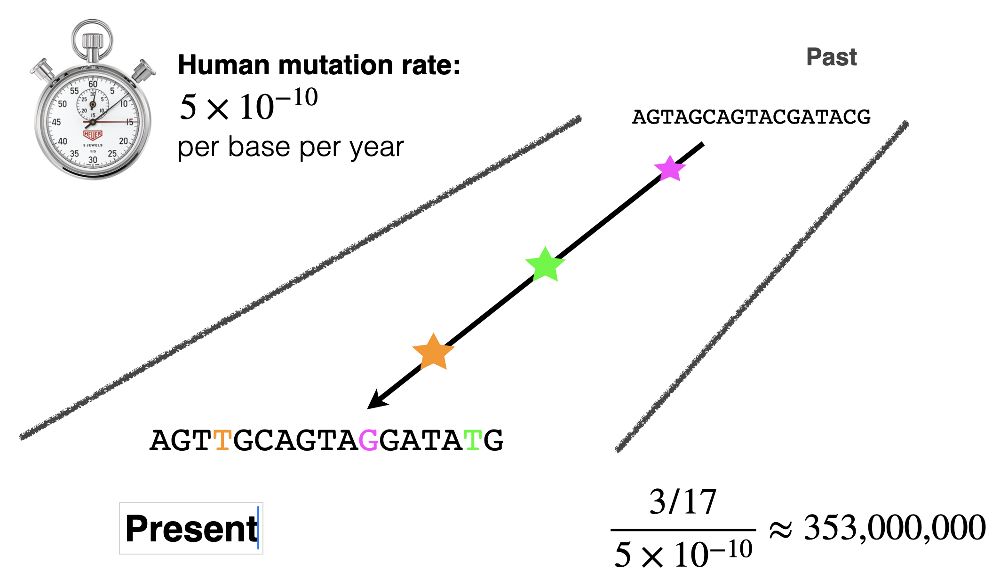

```{python}
#| echo: false
#| output: false
import numpy as np
import matplotlib.pyplot as plt
import matplotlib.transforms as transforms
import seaborn as sns
import vscodenb
sns.set_style('ticks')
```


## DNA sequence divergence across time


{width=80% #fig-divergence-tree}


{width=80%  #molecular-clock}


Substitituion rate is $r = \frac{K}{2T}$ where $K$ is the number of substitutions. So The divergence time is $T = \frac{K}{2r}$.


### A model of DNA evolution


P(x|y, t)

<style>
evol {font-family: "Lucida Console", "Courier New", monospace; letter-spacing: 30%; font-weight: bold; color: #555555 ;}
rd { color: Red ; font-weight: bold; }
or { color: Orange ; font-weight: bold;  }
gr { color: Green ; font-weight: bold;  }
bl { color: Blue ; font-weight: bold;  }
</style>

Distant past
<evol>
GCTTGCACGA<br>
GCTTG<gr>A</gr>ACGA<br>
GCTTG<gr>A</gr>ACGA<br>
GCT<bl>C</bl>G<gr>A</gr>ACGA<br>
GCT<bl>C</bl>G<gr>A</gr>ACGA<br>
GC<gr>A</gr><bl>C</bl>G<gr>A</gr>ACG<rd>T</rd><br>
GC<gr>A</gr><rd>T</rd>G<gr>A</gr>ACG<rd>T</rd><br>
GC<gr>A</gr><rd>T</rd>G<gr>A</gr>ACG<rd>T</rd><br>
GC<gr>A</gr><rd>T</rd>G<or>G</or>ACG<rd>T</rd><br>
GC<gr>A</gr><rd>T</rd>G<or>G</or>ACG<rd>T</rd><br>
</evol>
Present

### Jukes-Cantor model


```{python}
#| echo: false
#| label: fig-jc-inverse-example
#| fig-cap: "Jukes-Cantor model of DNA evolution"
#| layout-ncol: 2
#| fig-subcap:
#|   - "Across three times as much time the proportion of sequence differences roughly doubles."
#|   - "Given enough time, the proportion proportion of sequence differences approaches 0.75." 

# #| fig-subcap: true

u = 1e-8

def jc(subst):
    return -3/4 * np.log(1 - 4/3 * subst) / u

def jc_inverse(t):
    return -3/4 * (np.exp(-4/3 * t * u) - 1)

fig, ax = plt.subplots(figsize=(4, 3))
ax.axline((0,0), (1,u), ls='--', color='#999999')

for x in np.array([0.2, 0.6]) / u:
  y = jc_inverse(x)
  ax.vlines(x, 0, y, lw=1, color='black')
  ax.annotate('', xy=(0, y), xytext=(x, y), 
    arrowprops=dict(
          arrowstyle="-|>,head_length=0.7,head_width=0.3",
           color='black',
          lw=1),
    )
  ax.text(0.06, y+0.02, f'{y:.2f}', transform=transforms.blended_transform_factory(ax.transAxes, ax.transData))
ax.text(0.95, 0.1, rf'$\mu = ${u:.2g}', horizontalalignment='right', transform=ax.transAxes)
t = np.linspace(0.01, 1*1e8, 100)
ax.plot(t, jc_inverse(t), color='#0D7D92', lw=2)
ax.set_xlim(left=0)
ax.set_ylim(bottom=0)
sns.despine()
plt.show()

fig, ax = plt.subplots(figsize=(4, 3))
# ax.axhline(0.75, ls='--', c='#999999')
# for x in [1, 6]:
#   y = jc_inverse(x)
#   ax.vlines(x, 0, y, lw=1, color='black')
#   ax.annotate('', xy=(0, y), xytext=(x, y), 
#     arrowprops=dict(
#           arrowstyle="-|>,head_length=0.7,head_width=0.3",
#            color='black',
#           lw=1),
#     )
#   ax.text(0.06, y+0.02, f'{y:.2f}', transform=transforms.blended_transform_factory(ax.transAxes, ax.transData))
t = np.linspace(0.01, 7, 100)
ax.plot(t, jc_inverse(t), c='#0D7D92', lw=2)
ax.set_xlim(left=0)
ax.set_ylim(0, 0.8)
sns.despine()
plt.show()
```


```{python}
#| echo: false
#| label: fig-jc
#| fig-cap: "Jukes-Cantor model of DNA evolution"

u = 1e-8

def jc(subst):
    return -3/4 * np.log(1 - 4/3 * subst) / u
    
def jc_inverse(t):
    return -3/4 * (np.exp(-4/3 * t * u) - 1)

fig, ax = plt.subplots(figsize=(4, 3))
subst = np.linspace(0, 0.749, 100)
ax.plot(subst, jc(subst), c='#0D7D92', lw=2)

```


```{python}
#| echo: false
#| label: fig-jc
#| fig-cap: "Jukes-Cantor model of DNA evolution"

u = 1e-8

def jc(subst):
    return -3/4 * np.log(1 - 4/3 * subst) / u
    
def jc_inverse(t):
    return -3/4 * (np.exp(-4/3 * t * u) - 1)

fig, ax = plt.subplots(figsize=(4, 3))
ax.axvspan(0.65, 0.75, color='gray', alpha=0.2)

# ax.axvline(0.75, ls='--', c='#999999')

# for x in [0.645, 0.67, 0.695, 0.72, 0.745]:
#   y = jc(x)
#   ax.vlines(x, 0, y, lw=1, color='black')
#   ax.annotate('', xy=(0, y), xytext=(x, y), 
#     arrowprops=dict(
#           arrowstyle="-|>,head_length=0.7,head_width=0.3",
#            color='black',
#           lw=1),
#     )
#   ax.text(0.08, y+0.05, f'{y:.2f}', transform=transforms.blended_transform_factory(ax.transAxes, ax.transData))

ax.text(0.1, 0.9, rf'$\mu = ${u:.2g}', horizontalalignment='left', transform=ax.transAxes)

subst = np.linspace(0, 0.749, 100)
ax.plot(subst, jc(subst), c='#0D7D92', lw=2)
ax.set_xlim(left=0)
ax.set_ylim(bottom=0)
ax.text(0.9, 0.7, '"twilight zone"', fontsize=11, horizontalalignment='right', transform=ax.transAxes)
sns.despine()
```


$$
p_A(t+\Delta t) = p_A(t) - p_A(t)\, \mu_A \Delta t + \sum_{x \neq A} p_x(t) \, \mu_{xA} \Delta t
$$

Where $p_A$ is the probabiilty that a base is A at time $t$, $p_x(T)$ is the probability that a base is $x \neq A$ at time $t$, $\mu_{A} = \sum_{x \neq A} \mu_{Ax}$ is the substitution rate from A to another base, and $\mu_{xA}$ is the mutation rate from a  base $x \neq A$ to A.


The probability that a base is A at time $t + \Delta t$ is

$$
p_A(t+\Delta t) = p_A(t) - p_A(t)\, \mu_A \Delta t + \sum_{x \neq A} p_x(t) \, \mu_{xA} \Delta t
$$

Vector of all four probabilities:

$$
\mathbf{p}(t) = (p_A(t),\ p_C(t),\ p_G(t),\ p_T(t))
$$

lets us produce the result for all bases:

$$
\mathbf{p}(t + \Delta t) = \mathbf{p}(t) + \mathbf{p}(t)Q\Delta t 
$$

where 

$$
Q = \begin{pmatrix}
-\mu_A & \mu_{AG} & \mu_{AC} & \mu_{AT} \\
\mu_{GA} & -\mu_G & \mu_{GC} & \mu_{GT} \\
\mu_{CA} & \mu_{CG} & -\mu_C &\mu_{CT} \\
\mu_{TA} & \mu_{TG} & \mu_{TC} & -\mu_T
\end{pmatrix}
$$


### Jukes-Cantor model

$$
\alpha = \frac{1}{4} \times \mu
$$

$$
Q = \begin{pmatrix}
-3\alpha & \alpha & \alpha & \alpha \\
  \alpha & -3\alpha & \alpha & \alpha \\
  \alpha & \alpha & -3\alpha & \alpha \\
  \alpha & \alpha & \alpha & -3\alpha 
\end{pmatrix}
$$

$$
Q = \begin{pmatrix}
-\frac{3\mu}{4} & \frac{\mu}{4} & \frac{\mu}{4} & \frac{\mu}{4} \\
\frac{\mu}{4} & -\frac{3\mu}{4} & \frac{\mu}{4} & \frac{\mu}{4} \\
\frac{\mu}{4} & \frac{\mu}{4} & -\frac{3\mu}{4} & \frac{\mu}{4} \\
\frac{\mu}{4} & \frac{\mu}{4} & \frac{\mu}{4} & -\frac{3\mu}{4} \\
\end{pmatrix}
$$

Going from one base to another in time $t$:

$$
Q = \left(
\begin{array}{cc}
\frac{1}{4} + \frac{3}{4} e^{t\mu}  & \frac{1}{4} - \frac{1}{4} e^{t\mu} & \frac{1}{4} - \frac{1}{4} e^{t\mu} & \frac{1}{4} - \frac{1}{4} e^{t\mu} \\[1.5ex]
 \frac{1}{4} - \frac{1}{4} e^{t\mu} & \frac{1}{4} + \frac{3}{4} e^{t\mu} & \frac{1}{4} - \frac{1}{4} e^{t\mu} & \frac{1}{4} - \frac{1}{4} e^{t\mu} \\[1.5ex]
 \frac{1}{4} - \frac{1}{4} e^{t\mu} & \frac{1}{4} - \frac{1}{4} e^{t\mu} & \frac{1}{4} + \frac{3}{4} e^{t\mu} & \frac{1}{4} - \frac{1}{4} e^{t\mu} \\[1.5ex]
 \frac{1}{4} - \frac{1}{4} e^{t\mu} & \frac{1}{4} - \frac{1}{4} e^{t\mu} & \frac{1}{4} - \frac{1}{4} e^{t\mu} & \frac{1}{4} + \frac{3}{4} e^{t\mu} \\
\end{array}
\right)
$$

If we measure time in numbers of *actual* mutations, \nu:

$$
\nu = \bigg(\frac{\mu}{4} + \frac{\mu}{4} + \frac{\mu}{4}\bigg)t \implies t\mu = \frac{4}{3}\nu
$$

$$
  P_{ij}(\nu) =
  \begin{cases}
    \, \frac{1}{4} + \frac{3}{4} e^{t\mu} & \text{if } i = j\\
    \, \frac{1}{4} - \frac{1}{4} e^{t\mu} & \text{if } i \neq j
  \end{cases}
$$

We can estimate the total probability of observed mutations, $p$, as the proportion of bases where two sequences differ:

$$
p = 3\times \bigg(\frac{1}{4} - \frac{1}{4} e^{-4\nu/3} \bigg)= \frac{3}{4} - \frac{3}{4} e^{-4\nu/3}
$$

If we isolate $\nu$ we get the Jukes-Cantor correction:

$$
\nu = -\frac{3}{4} \ln(1-\frac{4}{3}p)
$$

### Kimura's 2-parameter model

Just like the Jukes-Cantor model, we can find a correction formula that takes separate transition and transversion rates into account:


$$
Q = \begin{pmatrix}
-2\beta-\alpha & \beta & \alpha & \beta \\
  \beta & -2\beta-\alpha & \beta & \alpha \\
  \alpha & \beta & -2\beta-\alpha & \beta \\
  \beta & \alpha & \beta & -2\beta-\alpha
\end{pmatrix}
$$

where $\alpha$ is the transition rate and $\beta$ is the transversion rate.

d_{K2P} = - \frac{1}{2} \ln \big( 1 - 2P - Q\big) - \frac{1}{4} \ln \big( 2Q\big)


## Protein substitution matrices

## How the matrix is made

Goal: a score for every aligned residue pair (a, b), 20 × 20, symmetric → 210 distinct values. Positive if the pair occurs in real homologs more often than by chance, negative if less. Match/mismatch scoring cannot do this: I↔V (both hydrophobic, similar size) is common in evolution, W↔G is not.

Data ([Henikoff and Henikoff, 1992](https://doi.org/10.1073/pnas.89.22.10915)):

- BLOCKS database: ungapped multiple alignments of the conserved regions of protein families. >2000 blocks from >500 families.
- Ungapped → each column is a set of residues assumed homologous. Gaps play no part in the matrix.

Algorithm, for a chosen threshold X (%):

1. Cluster each block: sequences ≥ X % identical to any member of a cluster join it (single linkage).
2. Weight: a sequence in a cluster of n sequences gets weight 1/n, so each cluster counts as one sequence.
3. Count: in every column of every block, for every pair of sequences in different clusters, add the product of their weights to $f_{ij}$, where i, j are the two residues (unordered). Pairs within a cluster are not counted.
4. Sum $f_{ij}$ over all columns of all blocks.
5. Turn counts into observed frequencies $q_{ij}$, background frequencies $p_i$, chance frequencies $e_{ij}$, and log-odds scores $s_{ij}$ (formulas below).
6. Scale and round to integers.

The threshold:

- X = 62 → BLOSUM62. X = 80 → BLOSUM80. X = 45 → BLOSUM45.
- High X: few sequences merged, pairs of close relatives dominate the counts → matrix for close homologs.
- Low X: close relatives merged away, only distant pairs left → matrix for distant homologs.
- Clustering also stops families with many near-identical sequences from dominating the counts.

## Formulas

Counts, for each column, all residue pairs between sequences (in different clusters):

- $f_{ij}$ = (weighted) number of times residues i and j are paired, with $i \le j$ (unordered).

Observed pair frequency:

$$q_{ij} = \frac{f_{ij}}{\sum_{i \le j} f_{ij}}$$

Background frequency of residue i (its share of all pair members):

$$p_i = q_{ii} + \sum_{j \ne i} \frac{q_{ij}}{2}$$

Expected pair frequency if residues were paired at random:

$$e_{ij} = \begin{cases} p_i^2 & i = j \\ 2 p_i p_j & i \ne j \end{cases}$$

(2 because i–j and j–i are the same unordered pair.)

Log-odds score:

$$s_{ij} = \log_2 \frac{q_{ij}}{e_{ij}} \quad \text{(bits)}$$

Published matrix entry: scaled and rounded to integer,

$$S_{ij} = \mathrm{round}\left(\tfrac{1}{\lambda} \, s_{ij}\right)$$

- BLOSUM62 is in half-bits: $S_{ij} = \mathrm{round}(2 \log_2 (q_{ij}/e_{ij}))$.
- Some (e.g. BLOSUM50) are in third-bits.


## Interpretation

- $S > 0$: pair observed more often than chance. $S < 0$: less. $S = 0$: as expected.
- Alignment score, ungapped: $S = \sum_k S(a_k, b_k)$. Sum of logs = log of product.
- Two models for an aligned pair of sequences:
  - related: pairs drawn with probabilities $q_{ij}$
  - unrelated: residues drawn independently with $p_i$, $p_j$
- $S$ (in bits) $= \log_2 \dfrac{P(\text{alignment} \mid \text{related})}{P(\text{alignment} \mid \text{unrelated})}$. Each half-bit unit in BLOSUM62 = factor $\sqrt{2}$.
- Rare residues get large diagonal scores: an identity between rare residues is less likely by chance. W–W = 11, C–C = 9, A–A = 4.
- Every substitution matrix implies target frequencies $q_{ij} = p_i p_j \, 2^{s_{ij}}$ ([Altschul, 1991](https://doi.org/10.1016/0022-2836(91)90193-A)).


## Two summary numbers (bits)

- Relative entropy, the average information per aligned pair in true homologs:
  $H = \sum_{i \le j} q_{ij} \, s_{ij}$
- Expected score of a random pair:
  $E = \sum_{i \le j} e_{ij} \, s_{ij}$
- E must be < 0 for local alignment, otherwise random sequences give arbitrarily long high-scoring alignments ([Karlin and Altschul, 1990](https://doi.org/10.1073/pnas.87.6.2264)).
- BLOSUM62: H = 0.6979, E = −0.5209 (Henikoff and Henikoff 1992, Table 1).
- Higher BLOSUM number → higher H → more information per position → shorter alignments are detectable, but only for close homologs.


## Selected BLOSUM62 values (checked against Biopython 1.88)

| pair | score | pair | score |
|---|---|---|---|
| W–W | 11 | I–V | 3 |
| C–C | 9 | F–Y | 3 |
| P–P | 7 | L–I | 2 |
| G–G | 6 | D–E | 2 |
| A–A | 4 | K–R | 2 |
| L–L | 4 | A–S | 1 |
| | | C–A | 0 |
| | | W–G | −2 |
| | | L–D | −4 |

- Diagonal range 4 to 11. Off-diagonal range −4 to 3.
- Matrix in Biopython also has B (D/N), Z (E/Q), X (any), * (stop).


## Toy example (computed)

Block of 5 sequences, 3 columns, no clustering:

```
AAC
ASC
AAC
SAC
AAW
```


- 5 sequences → $\binom{5}{2} = 10$ pairs per column → 30 pairs.

| pair | $f$ | $q$ | $e$ | $\log_2(q/e)$ | half-bits |
|---|---|---|---|---|---|
| A–A | 12 | 0.400 | 0.284 | 0.49 | 1 |
| A–S | 8 | 0.267 | 0.142 | 0.91 | 2 |
| C–C | 6 | 0.200 | 0.071 | 1.49 | 3 |
| C–W | 4 | 0.133 | 0.036 | 1.91 | 4 |

- $p_A = 0.533$, $p_C = 0.267$, $p_S = 0.133$, $p_W = 0.067$.
- C–W beats C–C, A–S beats A–A: scores are relative to chance, and S and W are rare. Small data → odd matrix.
- Unobserved pairs (e.g. A–C) have $q = 0$ → score $-\infty$. Real data: enough counts that this does not happen.

```python
from itertools import combinations
from collections import Counter
from math import log2

block = ["AAC", "ASC", "AAC", "SAC", "AAW"]

f = Counter()
for column in zip(*block):
    for a, b in combinations(column, 2):
        f[tuple(sorted((a, b)))] += 1

total = sum(f.values())
q = {pair: count / total for pair, count in f.items()}

residues = sorted(set("".join(block)))
p = {}
for i in residues:
    p[i] = q.get((i, i), 0) + sum(v / 2 for (a, b), v in q.items() if a != b and i in (a, b))

for (i, j), qij in sorted(q.items()):
    eij = p[i] ** 2 if i == j else 2 * p[i] * p[j]
    print(i, j, round(2 * log2(qij / eij)))
```


## Using it

```python
from Bio.Align import substitution_matrices
blosum62 = substitution_matrices.load("BLOSUM62")
blosum62["W"]["W"]   # 11.0
substitution_matrices.load()  # list of available matrices
```

Ungapped score example, `MKTAYIAK` vs `MKSAFVAR`:

```
M K T A Y I A K
M K S A F V A R
5 5 1 4 3 3 4 2   → 27
```

- Gaps: not covered by BLOSUM. Affine gap penalty chosen separately, empirically. BLASTP default: BLOSUM62, gap open 11, extend 1.
- Plugs straight into Needleman–Wunsch / Smith–Waterman in place of match/mismatch scores (link to alignment project).

## PAM, for contrast

- Dayhoff et al. 1978 (Atlas of Protein Sequence and Structure, vol. 5 suppl. 3).
- Built from close sequences (≥ 85 % identical), global alignments, phylogenetic trees → counts of accepted point mutations.
- PAM1 = 1 accepted substitution per 100 residues. PAMn = PAM1 matrix raised to power n (Markov chain), then log-odds.
- Distant matrices are extrapolated from close data. BLOSUM is counted directly at each distance.
- Number runs the other way: high PAM = distant, high BLOSUM = close.
- Rough equivalences: PAM250 ≈ BLOSUM45, PAM160 ≈ BLOSUM62, PAM120 ≈ BLOSUM80.
- Henikoff and Henikoff 1992: BLOSUM62 outperformed PAM matrices in database searches → became BLAST default.

## Choosing a matrix

- BLOSUM80: close homologs. BLOSUM62: general default. BLOSUM45: distant homologs.
- NCBI guidance by query length: < 35 aa PAM30; 35–50 PAM70; 50–85 BLOSUM80; > 85 BLOSUM62.

## Side facts

- The BLOSUM62 everyone uses was computed by buggy clustering code; the corrected matrix (RBLOSUM62) searches slightly worse ([Styczynski et al., 2008](https://doi.org/10.1038/nbt0308-274)).
- BLOSUM62 ungapped Karlin–Altschul parameters: λ ≈ 0.318 (nats per score unit), K ≈ 0.134 (used in `blast.ipynb`). Ideal half-bit λ would be ln 2 / 2 ≈ 0.347; the difference comes from rounding.
- Matrices assume positions independent and the same matrix at every site; neither is true (buried vs exposed sites differ).

