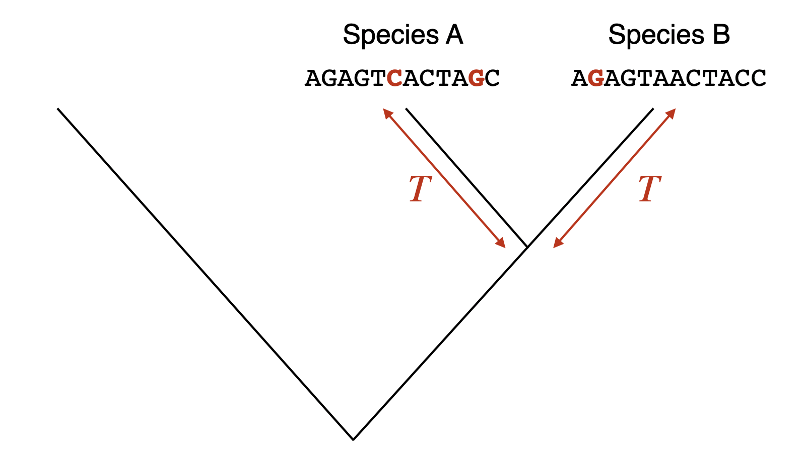

{width=20%}

```{python}
#| echo: false
#| output: false
import numpy as np
import matplotlib.pyplot as plt
import matplotlib.transforms as transforms
import seaborn as sns
import vscodenb
sns.set_style('ticks')
```


## DNA sequence divergence across time {#sec-molevo-divergence}

Every time a cell divides, its DNA is copied, and once in a while the copy has a mistake. Most such mutations that end up being passed on through the generations are neutral: they change the DNA without changing anything the organism depends on. Because neutral mutations arise at a roughly steady rate and are neither favored nor removed by selection, they pile up in a lineage like the ticks of a clock. This is the *molecular clock*. If you know how fast the clock ticks, you can read off how long it has been running from the number of differences it has left behind.

{width=80% #fig-molecular-clock}

@fig-molecular-clock shows the idea for a single lineage. In practice we never have the ancestral sequence. What we have is two sequences from two living species, as in @fig-divergence-tree. Since the two species split from their common ancestor $T$ years ago, each lineage has been collecting substitutions for $T$ years, so the two sequences are separated by $2T$ years of evolution. If $K$ is the number of substitutions per site that separate them and $r$ is the substitution rate per site per year, then

$$
r = \frac{K}{2T} \qquad \text{and so} \qquad T = \frac{K}{2r}.
$$

{width=80% #fig-divergence-tree}

The two sequences in @fig-divergence-tree differ at 3 of their 12 sites, so $K = 0.25$. With $r = 5 \times 10^{-10}$, that gives $T = 0.25 / (2 \times 5 \times 10^{-10}) = 250$ million years. The calculation assumes that every substitution leaves a visible difference, and that is only true for closely related sequences. The rest of this section is about what happens when it is not.

### A model of DNA evolution {#sec-molevo-model}

<style>
evol {font-family: "Lucida Console", "Courier New", monospace; letter-spacing: 30%; font-weight: bold; color: #555555 ;}
rd { color: Red ; font-weight: bold; }
or { color: Orange ; font-weight: bold;  }
gr { color: Green ; font-weight: bold;  }
bl { color: Blue ; font-weight: bold;  }
</style>

::: {#fig-multiple-hits}

Distant past<br>
<evol>
GCTTGCACGA<br>
GCTTG<gr>A</gr>ACGA<br>
GCTTG<gr>A</gr>ACGA<br>
GCT<bl>C</bl>G<gr>A</gr>ACGA<br>
GCT<bl>C</bl>G<gr>A</gr>ACGA<br>
GC<gr>A</gr><bl>C</bl>G<gr>A</gr>ACG<rd>T</rd><br>
GC<gr>A</gr><rd>T</rd>G<gr>A</gr>ACG<rd>T</rd><br>
GC<gr>A</gr><rd>T</rd>G<gr>A</gr>ACG<rd>T</rd><br>
GC<gr>A</gr><rd>T</rd>G<or>G</or>ACG<rd>T</rd><br>
GC<gr>A</gr><rd>T</rd>G<or>G</or>ACG<rd>T</rd><br>
</evol>
Present

Six substitutions in a sequence of ten bases, read from the top down. Only three differences between the first and last sequence are visible. The fourth base changed from `T` to `C` and back to `T`, and the sixth changed twice, first to `A` and then to `G`.

:::

@fig-multiple-hits follows one sequence through time. Six substitutions happen, but comparing the first sequence with the last shows only three differences. One site changed and then changed back, which leaves no trace, and another changed twice, which looks like one change. The longer the sequences have been evolving apart, the more often a site is hit more than once, and the more the observed proportion of differences underestimates the number of substitutions that actually happened. To correct for this, we need a model of how bases change over time: a way to compute the probability that a site holds base $x$ now, given that it held base $y$ a time $t$ ago.

Think of a single site. Let $p_A(t)$ be the probability that it holds an `A` at time $t$, and likewise for the other three bases. Over a short time $\Delta t$, two things can change $p_A$. If the site is an `A`, it may mutate to another base, which happens at a rate $\mu_A$. And if it is some other base $x$, it may mutate to an `A`, which happens at a rate $\mu_{xA}$. So

$$
p_A(t+\Delta t) = p_A(t) - p_A(t)\, \mu_A \Delta t + \sum_{x \neq A} p_x(t) \, \mu_{xA} \Delta t,
$$

where $\mu_A = \sum_{x \neq A} \mu_{Ax}$ is the total rate at which an `A` turns into something else. The same equation holds for each of the four bases. Collecting the four probabilities in a vector,

$$
\mathbf{p}(t) = (p_A(t),\ p_C(t),\ p_G(t),\ p_T(t)),
$$

all four equations can be written as one:

$$
\mathbf{p}(t + \Delta t) = \mathbf{p}(t) + \mathbf{p}(t)\,Q\,\Delta t,
$$

where $Q$ is the *rate matrix*. Its entry in row $x$ and column $y$ is the rate at which base $x$ mutates to base $y$, and each diagonal entry is minus the total rate of leaving that base, so that every row sums to zero:

$$
Q = \begin{pmatrix}
-\mu_A & \mu_{AC} & \mu_{AG} & \mu_{AT} \\
\mu_{CA} & -\mu_C & \mu_{CG} & \mu_{CT} \\
\mu_{GA} & \mu_{GC} & -\mu_G & \mu_{GT} \\
\mu_{TA} & \mu_{TC} & \mu_{TG} & -\mu_T
\end{pmatrix}
$$

Different models of DNA evolution are different choices for the twelve rates in $Q$.

### Jukes-Cantor model {#sec-molevo-jc}

The simplest model, from [Jukes and Cantor (1969)](https://doi.org/10.1016/B978-1-4832-3211-9.50009-7), assumes that every base mutates to each of the three others at the same rate, $\alpha$. With $\alpha = \mu / 4$, the rate matrix is

$$
Q = \begin{pmatrix}
-3\alpha & \alpha & \alpha & \alpha \\
  \alpha & -3\alpha & \alpha & \alpha \\
  \alpha & \alpha & -3\alpha & \alpha \\
  \alpha & \alpha & \alpha & -3\alpha
\end{pmatrix}
= \begin{pmatrix}
-\frac{3\mu}{4} & \frac{\mu}{4} & \frac{\mu}{4} & \frac{\mu}{4} \\
\frac{\mu}{4} & -\frac{3\mu}{4} & \frac{\mu}{4} & \frac{\mu}{4} \\
\frac{\mu}{4} & \frac{\mu}{4} & -\frac{3\mu}{4} & \frac{\mu}{4} \\
\frac{\mu}{4} & \frac{\mu}{4} & \frac{\mu}{4} & -\frac{3\mu}{4} \\
\end{pmatrix}.
$$

Letting $\Delta t$ shrink towards zero turns the equation for $\mathbf{p}$ into a differential equation, and for this simple $Q$ it can be solved by hand. The solution gives the probability of going from one base to another in time $t$, as a matrix $P(t)$ whose entry in row $i$ and column $j$ is the probability that a site holding base $i$ holds base $j$ a time $t$ later:

$$
P(t) = \left(
\begin{array}{cccc}
\frac{1}{4} + \frac{3}{4} e^{-t\mu}  & \frac{1}{4} - \frac{1}{4} e^{-t\mu} & \frac{1}{4} - \frac{1}{4} e^{-t\mu} & \frac{1}{4} - \frac{1}{4} e^{-t\mu} \\[1.5ex]
 \frac{1}{4} - \frac{1}{4} e^{-t\mu} & \frac{1}{4} + \frac{3}{4} e^{-t\mu} & \frac{1}{4} - \frac{1}{4} e^{-t\mu} & \frac{1}{4} - \frac{1}{4} e^{-t\mu} \\[1.5ex]
 \frac{1}{4} - \frac{1}{4} e^{-t\mu} & \frac{1}{4} - \frac{1}{4} e^{-t\mu} & \frac{1}{4} + \frac{3}{4} e^{-t\mu} & \frac{1}{4} - \frac{1}{4} e^{-t\mu} \\[1.5ex]
 \frac{1}{4} - \frac{1}{4} e^{-t\mu} & \frac{1}{4} - \frac{1}{4} e^{-t\mu} & \frac{1}{4} - \frac{1}{4} e^{-t\mu} & \frac{1}{4} + \frac{3}{4} e^{-t\mu} \\
\end{array}
\right)
$$

At $t = 0$ the diagonal entries are 1 and the others are 0: nothing has had time to change. As $t$ grows, every entry approaches $\frac{1}{4}$: after a very long time, the site is equally likely to hold any base, whatever it started as.

It is more useful to measure time by the number of substitutions that have actually happened per site, which we call $\nu$. A site leaves its base at the rate $\frac{\mu}{4} + \frac{\mu}{4} + \frac{\mu}{4}$, so

$$
\nu = \frac{3\mu}{4}\, t \quad \implies \quad t\mu = \frac{4}{3}\nu,
$$

and the transition probabilities become

$$
  P_{ij}(\nu) =
  \begin{cases}
    \, \frac{1}{4} + \frac{3}{4} e^{-4\nu/3} & \text{if } i = j\\[0.5ex]
    \, \frac{1}{4} - \frac{1}{4} e^{-4\nu/3} & \text{if } i \neq j
  \end{cases}
$$

When we compare two sequences, $\nu$ is the number of substitutions per site along the whole path from one sequence back to their common ancestor and forward to the other, which is the $K$ of the molecular clock. A site differs between the two sequences if it has ended up as any of the three other bases, so the expected proportion of sites that differ is

$$
p = 3\times \bigg(\frac{1}{4} - \frac{1}{4} e^{-4\nu/3} \bigg)= \frac{3}{4} - \frac{3}{4} e^{-4\nu/3}.
$$

@fig-jc-inverse-example shows what this means. For a short time, $p$ grows almost in step with the number of substitutions, along the dashed line. Then it bends away, because more and more new substitutions land on sites that already differ. Eventually $p$ levels off at $\frac{3}{4}$: two unrelated sequences still agree at a quarter of their sites, just by chance.

```{python}
#| echo: false
#| label: fig-jc-inverse-example
#| fig-cap: "The proportion of sites that differ between two sequences under the Jukes-Cantor model."
#| layout-ncol: 2
#| fig-subcap:
#|   - "With substitutions accumulating at $10^{-8}$ per site per year between the two sequences. The dashed line is what we would see if no site were ever hit twice. Three times as much time only a little more than doubles the proportion of differences."
#|   - "Against the number of substitutions per site, $\\nu$. However many substitutions have happened, the proportion of differences never exceeds 0.75 (dashed line)."

u = 1e-8

def jc(subst):
    return -3/4 * np.log(1 - 4/3 * subst) / u

def jc_inverse(t):
    return -3/4 * (np.exp(-4/3 * t * u) - 1)

fig, ax = plt.subplots(figsize=(4, 3))
ax.axline((0,0), (1,u), ls='--', color='#999999')

for x in np.array([0.2, 0.6]) / u:
  y = jc_inverse(x)
  ax.vlines(x, 0, y, lw=1, color='black')
  ax.annotate('', xy=(0, y), xytext=(x, y),
    arrowprops=dict(
          arrowstyle="-|>,head_length=0.7,head_width=0.3",
           color='black',
          lw=1),
    )
  ax.text(0.06, y+0.02, f'{y:.2f}', transform=transforms.blended_transform_factory(ax.transAxes, ax.transData))
ax.text(0.95, 0.1, rf'$\mu = ${u:.2g}', horizontalalignment='right', transform=ax.transAxes)
t = np.linspace(0.01, 1*1e8, 100)
ax.plot(t, jc_inverse(t), color='#0D7D92', lw=2)
ax.set_xlim(left=0)
ax.set_ylim(bottom=0)
ax.set_xlabel('time (years)')
ax.set_ylabel('proportion of sites that differ, $p$')
sns.despine()
plt.show()

fig, ax = plt.subplots(figsize=(4, 3))
ax.axhline(0.75, ls='--', c='#999999')
nu = np.linspace(0, 7, 200)
ax.plot(nu, 3/4 * (1 - np.exp(-4/3 * nu)), c='#0D7D92', lw=2)
ax.set_xlim(left=0)
ax.set_ylim(0, 0.8)
ax.set_xlabel(r'substitutions per site, $\nu$')
ax.set_ylabel('proportion of sites that differ, $p$')
sns.despine()
plt.show()
```

What we observe is $p$, and what we want is $\nu$. Solving the equation for $\nu$ gives the *Jukes-Cantor correction*:

$$
\nu = -\frac{3}{4} \ln\Big(1-\frac{4}{3}p\Big)
$$

For small $p$, the correction hardly matters: $p = 0.05$ gives $\nu = 0.052$. For large $p$, it matters a lot: $p = 0.5$ gives $\nu = 0.82$, so the observed differences hide more than a third of the substitutions. The corrected $\nu$ is what goes into the molecular clock as $K$.

@fig-jc turns the correction into time. Because the curve in @fig-jc-inverse-example flattens out, the estimated time shoots up as $p$ approaches 0.75, and a small error in $p$, which you always have with sequences of limited length, becomes a huge error in the time. Sequences that differ at more than about two thirds of their sites are in the *twilight zone*, where DNA comparisons can no longer tell how long ago two sequences diverged, or even whether they are related at all. This is one reason distant relatives are compared at the protein level, where the twilight zone comes much later.

```{python}
#| echo: false
#| label: fig-jc
#| fig-cap: "Time estimated with the Jukes-Cantor correction from the observed proportion of differences, with substitutions accumulating at $10^{-8}$ per site per year between the two sequences. In the gray twilight zone, a small change in the observed proportion gives a very different time."

u = 1e-8

def jc(subst):
    return -3/4 * np.log(1 - 4/3 * subst) / u

fig, ax = plt.subplots(figsize=(4, 3))
ax.axvspan(0.65, 0.75, color='gray', alpha=0.2)
ax.text(0.1, 0.9, rf'$\mu = ${u:.2g}', horizontalalignment='left', transform=ax.transAxes)
subst = np.linspace(0, 0.749, 100)
ax.plot(subst, jc(subst), c='#0D7D92', lw=2)
ax.set_xlim(left=0)
ax.set_ylim(bottom=0)
ax.set_xlabel('proportion of sites that differ, $p$')
ax.set_ylabel('estimated time (years)')
ax.text(0.9, 0.7, '"twilight zone"', fontsize=11, horizontalalignment='right', transform=ax.transAxes)
sns.despine()
plt.show()
```

### Kimura's 2-parameter model {#sec-molevo-k2p}

The four bases come in two chemical kinds. `A` and `G` are purines, with two rings, and `C` and `T` are pyrimidines, with one. A mutation that swaps a purine for a purine or a pyrimidine for a pyrimidine is a *transition*. One that swaps a purine for a pyrimidine, or the other way around, is a *transversion*. Transitions are chemically easier, and although there are twice as many kinds of transversion, transitions are observed about twice as often as all transversions together. The Jukes-Cantor model ignores this.

[Kimura (1980)](https://doi.org/10.1007/BF01731581) gave transitions their own rate, $\alpha$, and transversions another, $\beta$, as in @fig-k2p. Each base has one transition partner and two transversion partners, so with the bases in the order `A`, `C`, `G`, `T` the rate matrix is

$$
Q = \begin{pmatrix}
-2\beta-\alpha & \beta & \alpha & \beta \\
  \beta & -2\beta-\alpha & \beta & \alpha \\
  \alpha & \beta & -2\beta-\alpha & \beta \\
  \beta & \alpha & \beta & -2\beta-\alpha
\end{pmatrix}.
$$

```{python}
#| echo: false
#| label: fig-k2p
#| fig-cap: "Kimura's 2-parameter model. Transitions (solid blue) swap a purine for a purine or a pyrimidine for a pyrimidine and happen at rate $\\alpha$. Transversions (dashed orange) swap a purine for a pyrimidine and happen at rate $\\beta$."
fig, ax = plt.subplots(figsize=(3.6, 3.2))
pos = {'A': (0, 1), 'G': (1, 1), 'C': (0, 0), 'T': (1, 0)}
for a, b in [('A', 'G'), ('C', 'T')]:
    (x1, y1), (x2, y2) = pos[a], pos[b]
    ax.plot([x1, x2], [y1, y2], color='#2a78d6', lw=3, zorder=1)
    ax.text((x1 + x2) / 2, y1 + 0.08, r'$\alpha$', ha='center', fontsize=14, color='#0b0b0b')
for a, b in [('A', 'C'), ('G', 'T'), ('A', 'T'), ('G', 'C')]:
    (x1, y1), (x2, y2) = pos[a], pos[b]
    ax.plot([x1, x2], [y1, y2], color='#eb6834', lw=2, ls='--', zorder=1)
ax.text(-0.13, 0.5, r'$\beta$', ha='center', va='center', fontsize=14)
ax.text(1.13, 0.5, r'$\beta$', ha='center', va='center', fontsize=14)
ax.text(0.5, 0.62, r'$\beta$', ha='center', va='center', fontsize=14)
for base, (x, y) in pos.items():
    ax.add_patch(plt.Circle((x, y), 0.13, facecolor='white', edgecolor='#0b0b0b', lw=1.5, zorder=2))
    ax.text(x, y, base, ha='center', va='center', fontsize=15, family='monospace',
            fontweight='bold', zorder=3)
ax.text(0.5, 1.3, 'purines', ha='center', fontsize=10, color='#52514e')
ax.text(0.5, -0.33, 'pyrimidines', ha='center', fontsize=10, color='#52514e')
ax.set_xlim(-0.35, 1.35)
ax.set_ylim(-0.45, 1.42)
ax.set_aspect('equal')
ax.axis('off')
plt.show()
```

In the same way as for the Jukes-Cantor model, solving this model gives a correction formula. If $s$ is the observed proportion of sites that differ by a transition, and $v$ the proportion that differ by a transversion, the number of substitutions per site is

$$
d_{K2P} = - \frac{1}{2} \ln \big( 1 - 2s - v\big) - \frac{1}{4} \ln \big( 1 - 2v\big).
$$

When transitions and transversions do happen at the rates the Jukes-Cantor model assumes ($\alpha = \beta$), the two formulas give about the same answer. When transitions are more common, as they nearly always are, the Kimura correction is larger, because the frequent transitions saturate sooner and hide more of the substitutions.

## Protein substitution matrices {#sec-molevo-blosum}

To align two proteins, you need a score for every pair of amino acids that can end up in the same column, as in [the pairwise alignment chapter](pairwise-alignment.qmd#sec-pa-matrices). With 20 amino acids that is a $20 \times 20$ table, and since a pair scores the same whichever sequence each amino acid is in, there are 210 different scores to decide. The scores should be positive for pairs that turn up together in related proteins more often than by chance, and negative for pairs that turn up together less often. A score of "same or different", as we used for DNA, cannot do this. In real proteins, an isoleucine is often replaced by a valine, which is similar in size and also hydrophobic, while a tryptophan is almost never replaced by a glycine. The most widely used tables of this kind are the BLOSUM matrices ([Henikoff and Henikoff, 1992](https://doi.org/10.1073/pnas.89.22.10915)), and BLOSUM62 is the default in BLAST (see [the BLAST chapter](blast.qmd#blast-protein-search)).

### How the matrix is made {#sec-molevo-blosum-made}

The BLOSUM matrices are counted from real proteins. The data are the BLOCKS database: more than 2,000 ungapped multiple alignments of the conserved regions of more than 500 protein families. Because the blocks have no gaps, each column is a set of amino acids that are taken to descend from the same ancestral amino acid. Gaps therefore play no part in the matrix, and the gap scores for protein alignment are chosen separately.

The idea is to go through every column of every block, look at every pair of sequences, and count which two amino acids they have in that column. One problem is that some protein families are represented by many nearly identical sequences, which would dominate the counts and tell us mostly about pairs that have barely had time to change. So before counting, the sequences in each block are clustered: a sequence joins a cluster if it is at least $X$ percent identical to any sequence already in it. A sequence in a cluster of $n$ sequences then gets the weight $1/n$, so each cluster counts as a single sequence, and pairs of sequences within a cluster are not counted at all. For every pair of sequences in different clusters, the product of their weights is added to the count $f_{ij}$ for the two amino acids $i$ and $j$ they have in that column. Summed over all columns of all blocks, these counts are turned into scores, as described below.

The threshold $X$ gives the matrix its name: $X = 62$ gives BLOSUM62, $X = 80$ gives BLOSUM80, and $X = 45$ gives BLOSUM45. A high threshold merges few sequences, so the counts are dominated by close relatives, and the matrix is suited to comparing closely related proteins. A low threshold merges away the close relatives, so only distantly related pairs are counted, and the matrix is suited to distant relatives.

### From counts to scores {#sec-molevo-blosum-scores}

The counts are first turned into the *observed frequency* of each pair,

$$
q_{ij} = \frac{f_{ij}}{\sum_{i \le j} f_{ij}},
$$

where the sum runs over every pair once, so that `A`–`S` and `S`–`A` are the same pair. From these, the *background frequency* of each amino acid is its share of all the members of all the pairs. An amino acid paired with itself is both members of the pair, and one paired with another is half of it:

$$
p_i = q_{ii} + \sum_{j \ne i} \frac{q_{ij}}{2}.
$$

If amino acids were paired at random, the pair $i$–$j$ would turn up with the *expected frequency*

$$
e_{ij} = \begin{cases} p_i^2 & \text{if } i = j \\ 2 p_i p_j & \text{if } i \ne j, \end{cases}
$$

where the 2 is there because $i$ can be in either sequence. The score compares what was observed with what chance would give, as a *log-odds* score:

$$
s_{ij} = \log_2 \frac{q_{ij}}{e_{ij}}.
$$

A pair seen twice as often as chance scores 1, one seen half as often scores −1, and one seen exactly as often as chance scores 0. Because the logarithm has base 2, the score is measured in *bits*. The published matrix scales the scores and rounds them to whole numbers. BLOSUM62 is in half-bits, $S_{ij} = \mathrm{round}(2 \log_2 (q_{ij}/e_{ij}))$, while some other matrices, such as BLOSUM50, are in thirds of a bit.

To see the steps in action, take a tiny block of five sequences and three columns, and skip the clustering:

```txt
AAC
ASC
AAC
SAC
AAW
```

Five sequences make 10 pairs in each column, so 30 pairs in all. The background frequencies come out as $p_A = 0.533$, $p_C = 0.267$, $p_S = 0.133$ and $p_W = 0.067$, and the four pairs that occur get these scores:

```{python}
#| echo: false
#| output: asis
from itertools import combinations
from collections import Counter
from math import log2

block = ["AAC", "ASC", "AAC", "SAC", "AAW"]
f = Counter()
for column in zip(*block):
    for a, b in combinations(column, 2):
        f[tuple(sorted((a, b)))] += 1
total = sum(f.values())
q = {pair: count / total for pair, count in f.items()}
p = {}
for i in sorted(set("".join(block))):
    p[i] = q.get((i, i), 0) + sum(v / 2 for (a, b), v in q.items() if a != b and i in (a, b))

print("| Pair | $f$ | $q$ | $e$ | $\\log_2(q/e)$ | Half-bits |")
print("|:-:|--:|--:|--:|--:|--:|")
for (i, j), qij in sorted(q.items()):
    eij = p[i] ** 2 if i == j else 2 * p[i] * p[j]
    s = log2(qij / eij)
    print(f"| {i}–{j} | {f[(i, j)]} | {qij:.3f} | {eij:.3f} | {s:.2f} | {round(2 * s)} |")
```

Two things in the table may surprise you. `C`–`W` scores higher than `C`–`C`, and `A`–`S` scores higher than `A`–`A`, even though identical amino acids are paired more often. Scores measure how surprising a pair is compared with chance, and `S` and `W` are rare, so seeing them at all in a pair is surprising. And the pairs that never occur, like `A`–`C`, have $q = 0$, which would give them a score of minus infinity. With so little data, the matrix is odd. The real BLOCKS data hold enough pairs that every combination is seen.

### Reading the matrix {#sec-molevo-blosum-reading}

@fig-blosum62 shows the whole of BLOSUM62. The diagonal is all positive, from 4 to 11: an amino acid is most often replaced by itself, meaning not replaced at all. Rare amino acids score highest when they match, because a match between two rare amino acids is unlikely by chance: tryptophan with tryptophan scores 11 and cysteine with cysteine 9, while alanine with alanine scores 4. Off the diagonal, the scores run from −4 to 3, and the positive ones form small groups of chemically similar amino acids: isoleucine, leucine, valine and methionine; phenylalanine, tyrosine and tryptophan; lysine and arginine; aspartate and glutamate.

```{python}
#| echo: false
#| label: fig-blosum62
#| fig-cap: "The BLOSUM62 matrix, with the amino acids ordered so that chemically similar ones sit next to each other. Blue cells are pairs seen in related proteins more often than by chance, orange cells less often."
from matplotlib.colors import LinearSegmentedColormap, TwoSlopeNorm
from Bio.Align import substitution_matrices

blosum62 = substitution_matrices.load("BLOSUM62")
order = "CSTPAGNDEQHRKMILVFYW"
values = np.array([[blosum62[a][b] for b in order] for a in order])
cmap = LinearSegmentedColormap.from_list("div", ["#eb6834", "#f0efec", "#2a78d6"])
norm = TwoSlopeNorm(vmin=-4, vcenter=0, vmax=11)
fig, ax = plt.subplots(figsize=(6.4, 6.4))
ax.imshow(values, cmap=cmap, norm=norm)
for r in range(len(order)):
    for c in range(len(order)):
        v = int(values[r, c])
        ax.text(c, r, str(v).replace("-", "−"), ha="center", va="center", fontsize=8,
                color="white" if v >= 7 else "#0b0b0b")
ax.set_xticks(range(len(order)), list(order), family="monospace", fontsize=10)
ax.set_yticks(range(len(order)), list(order), family="monospace", fontsize=10)
ax.xaxis.tick_top()
ax.tick_params(length=0)
for side in ax.spines.values():
    side.set_visible(False)
plt.show()

# For @fig-blosum-compare: mean identity score and mean substitution score in
# bits, and the relative entropy as given in each matrix's own header.
blosum_stats = {}
for name, unit in {"BLOSUM45": 3, "BLOSUM62": 2, "BLOSUM80": 3}.items():
    m = substitution_matrices.load(name)
    identity = np.mean([m[a][a] / unit for a in order])
    substitution = np.mean([m[a][b] / unit for a in order for b in order if a < b])
    entropy_line = next(line for line in m.header if line.startswith("Entropy"))
    entropy = float(entropy_line.split("=")[1].split(",")[0])
    blosum_stats[name] = (identity, substitution, entropy)
```

The log-odds form makes the score of an alignment meaningful. Think of two ways an aligned pair of sequences could have come about. Either they are related, so that each column is a pair drawn with the observed frequencies $q_{ij}$, or they are unrelated, so that each amino acid is drawn on its own with the background frequencies. The score of an ungapped alignment is the sum of the scores of its columns, and a sum of logarithms is the logarithm of a product. So the total score in bits is

$$
S = \log_2 \frac{P(\text{alignment} \mid \text{related})}{P(\text{alignment} \mid \text{unrelated})}.
$$

Every extra bit doubles how much more likely the alignment is if the sequences are related, and every half-bit unit in BLOSUM62 multiplies it by $\sqrt{2}$. Here is an ungapped alignment of two short peptides, scored with BLOSUM62:

```txt
M K T A Y I A K
M K S A F V A R
5 5 1 4 3 3 4 2   total 27
```

Every column scores positive: four identities, and four substitutions between similar amino acids. The relationship goes both ways, too. Any score matrix, even one made up by hand, implies a set of target frequencies $q_{ij} = p_i p_j \, 2^{s_{ij}}$: the frequencies of pairs in related sequences that it is best at finding ([Altschul, 1991](https://doi.org/10.1016/0022-2836(91)90193-A)).

Two numbers summarize a matrix. The *relative entropy* $H = \sum_{i \le j} q_{ij} \, s_{ij}$ is the average score per column in true relatives: how much information each aligned pair carries about whether two sequences are related. The *expected score* $E = \sum_{i \le j} e_{ij} \, s_{ij}$ is the average score per column for unrelated sequences. As you saw for [local alignment](pairwise-alignment.qmd#sec-pa-local), $E$ must be negative for local alignment to work, or random sequences would build up long high-scoring alignments ([Karlin and Altschul, 1990](https://doi.org/10.1073/pnas.87.6.2264)). For BLOSUM62, $H = 0.6979$ bits and $E = -0.5209$ bits ([Henikoff and Henikoff, 1992](https://doi.org/10.1073/pnas.89.22.10915)). A higher BLOSUM number gives a higher $H$: more information per column, so shorter alignments can be detected, but only between close relatives.

### Using the matrix {#sec-molevo-blosum-using}

You do not have to type in the matrix. Biopython has BLOSUM62 and many other matrices built in, and you look up a score with two amino acids, as in [the Biopython chapter](../python/biopython.ipynb#sec-biopython-align):

```python
from Bio.Align import substitution_matrices

blosum62 = substitution_matrices.load("BLOSUM62")
print(blosum62["W"]["W"])
print(substitution_matrices.load())   # the names of all the matrices
```

Besides the 20 amino acids, the matrix has rows for `B` (aspartate or asparagine), `Z` (glutamate or glutamine), `X` (any amino acid) and `*` (a stop codon). A substitution matrix plugs straight into the Needleman-Wunsch and Smith-Waterman algorithms of @sec-pairwise-alignment in place of the simple match and mismatch scores. The gap scores have to be chosen separately, and are found by trial. The default in `blastp` is BLOSUM62 with an affine gap score of 11 to open a gap and 1 to extend it.

### PAM, for contrast {#sec-molevo-pam}

Before BLOSUM, the standard matrices were the PAM matrices of Margaret Dayhoff and colleagues (Dayhoff et al., 1978). They were built differently. Dayhoff took closely related proteins, at least 85% identical, built evolutionary trees for them, and counted the substitutions along the branches. From those counts she made the matrix PAM1, which describes the changes expected when there has been one accepted substitution per 100 amino acids. Matrices for longer distances were made by applying PAM1 repeatedly, as a model like the ones in [A model of DNA evolution](#sec-molevo-model) does over time: PAM250 is PAM1 applied 250 times, and then turned into log-odds scores. So the PAM matrices for distant relatives are extrapolated from close relatives, while each BLOSUM matrix is counted directly from sequences at its distance.

The numbers run in opposite directions. A high PAM number means distant relatives, while a high BLOSUM number means close ones. Roughly, PAM250 corresponds to BLOSUM45, PAM160 to BLOSUM62, and PAM120 to BLOSUM80. When Henikoff and Henikoff compared them in database searches, BLOSUM62 found relatives better than the PAM matrices, and it became the default in BLAST.

### Choosing a matrix {#sec-molevo-choosing}

For most searches, BLOSUM62 is a good choice. If you are looking for close relatives, BLOSUM80 is better, and for distant relatives BLOSUM45. NCBI also bases its advice on the length of the query, because a short query gives a short alignment, and a short alignment can only stand out from chance if each column carries a lot of information: PAM30 for queries shorter than 35 amino acids, PAM70 for 35 to 50, BLOSUM80 for 50 to 85, and BLOSUM62 for anything longer.

@fig-blosum-compare shows why the three BLOSUM matrices suit different distances. The matrices are published in different units, BLOSUM62 in half-bits and the other two in thirds of a bit, so the figure converts every score to bits to make them comparable. Going from BLOSUM45 to BLOSUM80, the diagonal gets darker blue and the rest of the matrix darker orange. On average an identity is worth `{python} f"{blosum_stats['BLOSUM45'][0]:.1f}"` bits in BLOSUM45 and `{python} f"{blosum_stats['BLOSUM80'][0]:.1f}"` bits in BLOSUM80, while a substitution costs `{python} f"{-blosum_stats['BLOSUM45'][1]:.2f}"` bits in BLOSUM45 and `{python} f"{-blosum_stats['BLOSUM80'][1]:.2f}"` bits in BLOSUM80. BLOSUM80 was counted from close relatives, where substitutions are rare, so it treats every substitution as strong evidence against a relationship. BLOSUM45 was counted from distant relatives, where substitutions are common, so it forgives them. The relative entropy grows accordingly, from `{python} blosum_stats['BLOSUM45'][2]` bits per column for BLOSUM45 to `{python} blosum_stats['BLOSUM62'][2]` for BLOSUM62 and `{python} blosum_stats['BLOSUM80'][2]` for BLOSUM80.

```{python}
#| echo: false
#| label: fig-blosum-compare
#| fig-cap: "BLOSUM45, BLOSUM62 and BLOSUM80 side by side, with the amino acids in the same order as in @fig-blosum62. Every score is converted to bits and colored on the same scale in all three panels, so the same color means the same evidence for or against a relationship."
units = {"BLOSUM80": 3, "BLOSUM62": 2, "BLOSUM45": 3}
matrices = {name: substitution_matrices.load(name) for name in units}
bits_norm = TwoSlopeNorm(vmin=-8 / 3, vcenter=0, vmax=16 / 3)
fig, axes = plt.subplots(1, 4, figsize=(7.2, 2.8),
                         gridspec_kw={"width_ratios": [1, 1, 1, 0.06], 'hspace': 0.1})
labels = ['Close relatives search', 'BLAST default', 'Distant relatives search']
for ax, (name, unit), label in zip(axes[:3], units.items(), labels):
    m = matrices[name]
    bits = np.array([[m[a][b] for b in order] for a in order]) / unit
    image = ax.imshow(bits, cmap=cmap, norm=bits_norm)
    ax.set_xticks(range(len(order)), list(order), family="monospace", fontsize=5)
    ax.set_yticks(range(len(order)), list(order), family="monospace", fontsize=5)
    ax.xaxis.tick_top()
    ax.tick_params(length=0, pad=1)
    for side in ax.spines.values():
        side.set_visible(False)
    ax.set_title(name, fontsize=9, pad=12)
    ax.set_xlabel(label)
colorbar = fig.colorbar(image, cax=axes[3], ticks=range(-2, 6))
colorbar.ax.set_yscale("linear")    # one bit takes the same height everywhere on the bar
colorbar.set_ticks(range(-2, 6))
colorbar.ax.set_yticklabels([str(t).replace("-", "−") for t in range(-2, 6)], fontsize=7)
colorbar.set_label("score (bits)", fontsize=8)
colorbar.outline.set_visible(False)
#plt.tight_layout(w_pad=0.6)
plt.show()
```

Every substitution matrix rests on two simplifications. It assumes that each position in a protein evolves on its own, and that the same scores apply at every position. Neither is true. An amino acid buried in the core of a protein is under very different constraints from one on its surface. The matrices work well anyway, which says more about how useful a simple model can be than about how proteins evolve. Even the matrix itself is not quite what it was meant to be: the BLOSUM62 that everyone uses was computed with a mistake in the clustering code, and the corrected matrix turned out to find relatives slightly worse ([Styczynski et al., 2008](https://doi.org/10.1038/nbt0308-274)).
